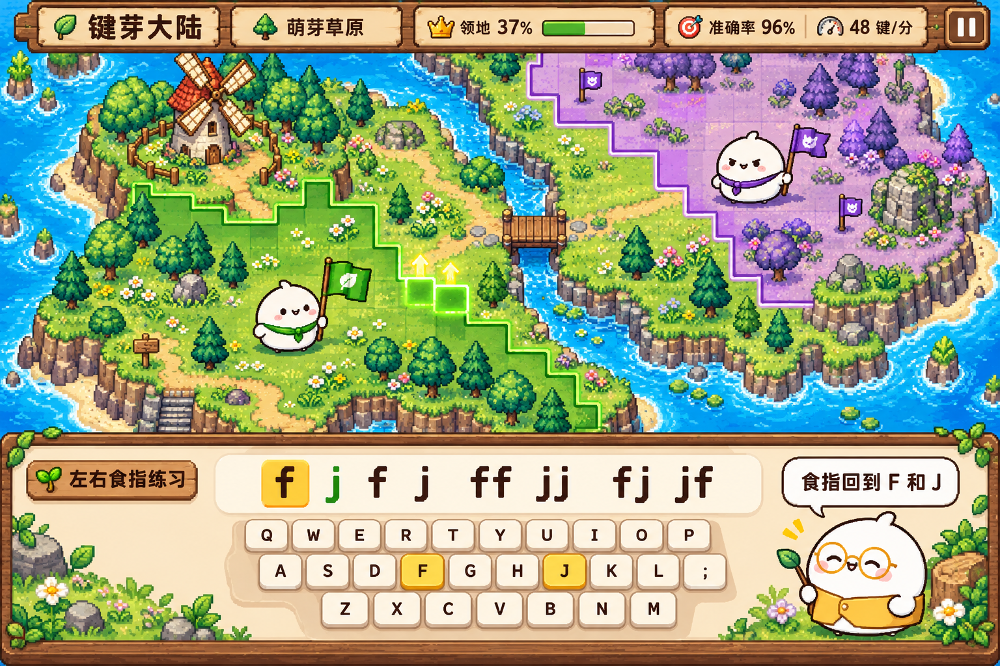

# 键芽大陆游戏策划

《键芽大陆》是一款面向小学三年级左右学生的网页版英文打字冒险游戏。玩家扮演白团子点点，从一个发光地图格出发，靠正确输入为家园充能，推动领地边界，最终收复整张地图。

游戏以准确输入、手位回归和稳定节奏为学习主线。领地争夺提供反馈和挑战；教学、暂停和休息不受敌人攻击。课程逐步覆盖英文字母、单词、句子和常用编辑快捷键。

## 1. 产品范围与体验目标

| 项目 | 规则 |
| --- | --- |
| 主要使用者 | 小学三年级左右、刚开始使用实体键盘的学生 |
| 设备 | 配有实体 QWERTY 键盘的电脑，支持 Windows 和 macOS |
| 语言 | 中文界面与教学，英文输入内容 |
| 游戏方式 | 单人对战电脑，自动扩张，不要求同时移动角色或操作鼠标 |
| 学习节奏 | 普通关目标约 3～5 分钟，综合关允许更长；随时暂停续玩 |
| 通关目标 | 本关所有可占领地块归玩家所有 |
| 保存方式 | 浏览器本地存档，并提供导出、导入 |
| 发布方式 | GitHub 管理源码，Cloudflare 静态部署 |

速度目标、地图规模和反攻强度是游戏参数，不是小学三年级学生的能力标准。关卡时长需要依据儿童实际试玩调整，课程不设倒计时失败。

完整游戏包含八章、每章四个关卡，共 32 关。每关是一张独立地图，章节共享地形素材和剧情主题。首先实现一张可从开始玩到通关的草原地图，再展开课程与素材。

首发范围不包含真人联网、账号、云端同步、排行榜、付费道具、中文拼音输入和手机软键盘训练。一个浏览器存放一个学习档案。

## 2. 人物与美术识别

### 2.1 共同造型

角色使用圆扁的白色糯团身体、头顶小揪、黑色豆豆眼、简单嘴形、粉色腮红、短手和小脚。情绪通过眼形、嘴形、身体倾斜和少量符号表达。

角色身份必须能在去掉颜色后区分：点点的领巾与旗帜、老师的眼镜、团团的长围巾、灰云王的皇冠构成不同剪影。地图角色使用像素精灵，教学和对话使用圆润线稿头像。

| 人物 | 外形 | 性格与职责 | 反馈方式 |
| --- | --- | --- | --- |
| 点点 | 白团子、绿色三角领巾、树叶小旗 | 好奇、认真，是玩家在地图中的化身 | 专注、疑惑、连击、举旗、休息六类表情 |
| 慢慢老师 | 白团子、金色圆眼镜、黄色小背心 | 示范手位、说明规则、提示需要重练的按键 | 短句说明；完成一个输入组后再说话 |
| 团团 | 白团子、紫色长围巾、歪歪的小旗 | 爱比赛的同行者，承担大部分电脑对战 | 蓄力、推进、受阻、认输；不嘲讽错误 |
| 灰云王 | 较大的灰白团子、云朵围领、小皇冠 | 占据云端城堡的最终对手 | 困倦、蓄力、惊讶、放下皇冠 |

角色不承担装备、数值养成或抽取系统。剧情伙伴不额外增加可操作单位。

### 2.2 图像与像素规格

- 地形以 16×16 像素图块组织；普通地图角色以 32×32 像素为制作基准，首领可用 48×48。
- 角色至少提供正面、侧面、背面与待机、推进、受阻、胜利动作；不要求八向行走。
- 对话头像使用独立的清晰线稿图，保留白团子表情，不能把大头像直接缩小充当地图精灵。
- 像素地图使用清晰色块、短阴影和适量材质，避免柔焦、拟真光效和满屏粒子。
- 字体与按钮保持清楚；正文不使用难以辨认的像素中文字体。
- 森林、风车、溪流、桥梁、云端建筑构成冒险氛围；人物和地图均采用项目自己的素材。

人物与界面视觉依据：




概念图用于确定造型、构图和氛围。正式地图需要可组合图块、独立角色精灵和实时绘制的领地边界；键盘、文字和按钮由真实界面元素生成。

## 3. 世界与主线剧情

灰云王把大陆的光收进云端城堡，草地、风车和村庄逐渐沉睡。点点发现脚下还剩一个亮点。慢慢老师告诉它：准确敲下键盘，就能产生新的光。

点点沿着草原、森林和海岸前进。团团最初想抢先到达城堡，后来成为一起恢复大陆的伙伴。每章恢复一个地方的生活，最后点点与团团用稳定的输入让云端城堡重新发光。

| 章节 | 剧情目标 | 收复后的变化 |
| --- | --- | --- |
| 萌芽草原 | 点亮第一片土地，学会给家园充能 | 草地长出花朵，家园升起小旗 |
| 溪流森林 | 沿着溪流接通森林道路 | 木桥亮起，溪边小屋重新开门 |
| 蘑菇丘陵 | 穿过容易迷路的蘑菇小径 | 路灯依次点亮，蘑菇恢复颜色 |
| 风车集市 | 帮居民恢复集市招牌 | 风车转动，摊位与路牌出现 |
| 灯塔海岸 | 整理灯塔信件，重新发出光信号 | 灯塔亮起，海面出现返航小船 |
| 齿轮工坊 | 用编辑技巧修好工坊中的指令 | 齿轮运转，通往山谷的升降台启动 |
| 星光山谷 | 把散落的英文短句连成路线 | 星光路标连接到云端 |
| 云端城堡 | 在灰云王的反攻中保持准确和节奏 | 云散开，灰云王恢复白色，所有角色一起举旗 |

每关开场对话最多两轮，每轮一条简短信息。第一次出现的新规则必须示范，已看过的剧情可跳过。剧情文字不进入速度统计。

教学示例：“两只食指先回到 F 和 J。”“这次先看准，再按。”“前方要反攻了，保持自己的节奏。”结算只报告本次表现和一个可执行建议，不与其他孩子比较。

## 4. 一局游戏的流程

```text
选择关卡 → 剧情与新键示范 → 手位准备 → 按键开始
                                         |
             ┌───────────────────────────┘
             v
        读取短练习组 → 正确输入 → 能量增加 → 领地推进
             ^             |
             |             └→ 连续正确带来额外能量
             |
        生成下一组 ← 完成当前组

        错误或持续低速 → 挑战中产生反攻压力

        全图收复 → 冻结战局 → 展示地图变化 → 结算并保存
```

1. 进入关卡后说明本关练什么，示范目标键和对应手指。
2. 玩家确认准备，按下首个有效练习键后才开始计时。
3. 每次只突出一个目标字符，提前显示一个短输入组。
4. 正确字符推动输入游标，能量达到门槛后自动扩张。
5. 输入组完成后换下一组，地图在同一战局中持续推进。
6. 收复全部可占领地块后立即结束模拟，奖励和课程进度只结算一次。

准备状态的非目标按键只给手位提示，不启动计时、不计错误。首个正确目标字符启动游戏，并正常计入正确次数和能量。

退出时保存当前战局。选择“重新开始本关”会明确提示本关战局将重新开始，已完成课程和历史成绩保留。

## 5. 输入判定与学习指标

### 5.1 常规字母、单词与句子关

正确字符必须与当前目标一致，包括已教授的大小写、空格和标点。输入错误时游标停留在原处，短暂标出错误按键；正确输入后继续。错误不会作为字符插入练习行。

退格、删除、文本选择和纠错在独立的编辑任务中练习，避免常规练习要求孩子删除一个并未真正输入的错字。

- 按住键自动重复不产生能量，也不重复扣分；相邻同字母需要松开后再次按下。
- 在普通练习中粘贴不推进游标、不产能；在复制粘贴任务中按任务目标判定。
- 修饰键、导航键和未要求的编辑操作不算字母错误；可用简短提示说明当前任务。
- 输入法组合期间不判错、不产能，提示切换英文输入后继续。
- 教学、弹窗、失焦、隐藏页面、暂停与恢复准备期均不产生反攻。
- 只在已聚焦的练习区接收游戏输入；菜单和系统快捷键保持可用。

### 5.2 指标定义

| 指标 | 定义与用途 |
| --- | --- |
| 正确次数 | 符合当前目标、实际推进游标的字符次数 |
| 错误次数 | 练习区收到的不匹配可打印字符次数 |
| 准确率 | 正确次数 ÷（正确次数＋错误次数）；没有输入时显示“—” |
| 正确字符/分 | 正确次数 ÷ 有效练习分钟数，界面标为“字/分” |
| 连击 | 连续正确输入数量；错误后归零 |
| 易错键 | 以目标字符记录尝试和错误，至少尝试 10 次后才给出排序 |

空格和标点在被正式教授后计入字符。有效练习时间包含正在游戏时的犹豫和普通停顿，不包含暂停和教学；结算速度不把休息时间算进去。

战斗速度取最近 15 秒有效练习时间内的正确字符折算为每分钟速度，暂停不推进这个窗口。开始和恢复后重新积累窗口，满 15 秒之前不触发低速反攻。WPM 如需用于开发对照，使用正确字符/分除以 5，儿童界面只显示一种速度单位。

### 5.3 指法范围

采用标准 QWERTY 手位。普通网页只能验证输入，无法判断实际用了哪根手指；完成关卡不宣称检测到了正确指法。

| 手指 | 负责的主要字母与符号键 |
| --- | --- |
| 左手小指 | Q A Z；左 Shift |
| 左手无名指 | W S X |
| 左手中指 | E D C |
| 左手食指 | R T F G V B |
| 右手食指 | Y U H J N M |
| 右手中指 | I K , |
| 右手无名指 | O L . |
| 右手小指 | P ; /、引号、右 Shift、Enter、Backspace |
| 拇指 | 空格；允许使用更舒适的一侧 |

数字行沿列映射：左手依次负责 1、2、3、4/5，右手依次负责 6/7、8、9、0。大小写练习示范与字母相反一侧的 Shift。教学提供手形图、目标手指名称和 F/J 凸点说明；进阶后可以关闭键盘提示。

## 6. 能量、扩张与反攻

### 6.1 能量规则

| 参数 | 开发初始值 | 含义 |
| --- | --- | --- |
| 单次正确输入 | ＋1 能量 | 推进一个目标字符 |
| 占领一格 | 2 能量 | 中立格和敌方格成本相同 |
| 连击奖励 | 每连续正确 10 次额外＋1 能量 | 奖励准确节奏，不增加独立货币 |
| 错误代价 | 有剩余能量时扣 1；否则增加 1 点反攻压力 | 同一次错误只执行其中一种代价 |
| 反攻压力上限 | 3 点 | 不累积无法恢复的攻击债务 |
| 普通反攻 | 每次消耗 1 点压力，占领至多 1 格 | 不按领地面积放大惩罚 |

能量足够时立即占领一个合法相邻格，扣除消耗后继续处理剩余能量。没有额外建造、兵种、资源生产或升级系统。

错误重置连击。教学保护期间只显示错误、重置连击，不扣能量、不产生反攻压力。进入挑战后才启用完整错误代价。

以 72 格地图为例，玩家从 1 格开始，需要收复另外 71 格，共消耗 142 能量。连续正确 130 次可获得 143 能量，足够通关；以每分钟 40 个正确字符输入，纯输入时间约 3.25 分钟。这是无错误、无失地、无教学停顿的算例。

### 6.2 学习与挑战

学习和挑战是同一关卡的两种游玩方式，使用相同知识范围与题库。

- **学习**：用于首次接触新按键和编辑任务，不产生反攻压力。团团可以做表情和预告示范，领地不主动增长。
- **挑战**：本关完成学习后解锁；错误和持续低速可引发反攻。挑战不阻塞下一关学习。
- 第一章首次进入始终使用学习方式。后续关卡进入新键示范时同样暂停对抗。
- 模式随战局保存；切换方式需要开始新战局，不改写已完成记录。

### 6.3 低速反攻

每个普通关卡提供一个目标速度，目标值随课程配置。只有挑战方式启用低速反攻。

最近 15 秒速度窗口完整后，若速度连续 5 秒低于本关目标，开始按以下速率生成压力：

```text
slowPressurePerSecond = 0.25 * max(0, 1 - recentCPM / targetCPM)
```

其中 recentCPM 为最近窗口的正确字符/分，targetCPM 必须大于零。连续低速时间在速度恢复到目标及以上时归零。压力可以累积小数，达到 1 点才允许反攻。

例如目标 30 字/分、当前 15 字/分，每秒生成 0.125 点压力；进入低速状态后约 8 秒形成一次反攻机会。当前速度为零时，每 4 秒生成一点压力。低于目标意味着对方获得推进机会，不保证玩家的净领地一定减少，净变化还取决于正确输入和错误次数。

产生至少 1 点压力后，先用 2 秒边界预告再执行普通反攻；两次普通反攻之间至少间隔 2 秒。恢复速度后停止产生低速压力，已经预告的攻击仍会完成。所有计时只使用正在游玩的有效时间。

### 6.4 家园保护与翻盘

玩家出生格不可被占领。对手不能一次吞掉整片领地，不能因为断路而让玩家成片失地。只剩家园时，孩子仍能靠正确输入重新扩张。

如果对手没有合法目标，本次攻击消耗压力但不转化为伤害，不把未执行攻击无限累积。敌方归零后本关不重生，剩余中立地仍需收复。

## 7. 地图与领地规则

### 7.1 地块类型

| 类型 | 可占领 | 规则 |
| --- | --- | --- |
| 中立草地、道路、浅色雾地 | 是 | 占领后变为本方地貌 |
| 己方地 | 已占领 | 构成可扩张前沿 |
| 敌方地 | 是 | 玩家可从相邻己方格夺取 |
| 玩家家园 | 受保护 | 始终属于玩家，占一格通关目标 |
| 河流、海面、不可通行峭壁 | 否 | 不计入领地百分比 |
| 桥梁、通行山口 | 是 | 接通两侧可占领区域，成本与普通格一致 |
| 风车、小屋等装饰 | 由底层地块决定 | 不额外阻塞扩张，避免素材与判定冲突 |

扩张只允许上下左右四邻接，不允许斜角穿越。所有计入通关的格子必须在静态地形上与家园相连。桥梁属于可通行图的一部分，地图生成后验证连通性。

玩家默认从一个格子起步。对手从另一端的一个格子起步，其余为中立地。可占领格数记为 N，领地百分比为玩家格数除以 N；100% 只有在实际获得 N 格后显示。

### 7.2 自动选择扩张位置

玩家候选格必须与己方地相邻，并且不是水面或其他不可占领地。优先选择距离家园较近的候选格；同距离使用本局种子决定顺序，形成可重复但有变化的生长边界。每占领一格重新计算候选位置。

对手从自己的前沿推进，优先接近玩家边界。对手夺取玩家地块前，检查剩余玩家地仍与家园连通；会切断领地的攻击跳过，改选其他合法目标。玩家夺取敌地可以把对方分成几个小片区，片区保持原所有权，不产生自动大片掉地。

敌方旗帜位置可以被夺取，旗帜迁往剩余敌地。对手所有领地都可以收复，没有阻止 100% 通关的永久敌方核心。

### 7.3 地图规模与镜头

- 首个可玩关卡使用 12×8 的逻辑网格，其中恰好 72 格可占领、24 格不可占领。
- 完整课程按目标练习量配置约 36～120 格可占领地，不把地图越大等同于课程越难。
- 开场放大一格家园，并用一圈描边明确位置；随着收复比例增加平缓拉远。
- 玩家可以选择固定全图视角。界面放大、手位图和地图缩放彼此独立。
- 领地变化同时使用颜色、边线和小旗表示，不能只靠绿紫配色区分。

## 8. 电脑对手与随机性

所有对手使用相同能量和压力来源，行为只改变推进节奏，不偷偷提高孩子的目标速度。

| 行为 | 规则 | 识别信号 |
| --- | --- | --- |
| 稳步推进 | 满足普通攻击条件时使用 1 点压力 | 小旗摇动，前沿一格闪烁 |
| 蓄力推进 | 攒到最多 3 点压力，预告后每秒推进一格，最多三格 | 团团鼓起脸，连续显示目标格 |
| 周期反攻 | 每 8 秒检查一次，最多使用 2 点现有压力；不足时按实际数量执行 | 敌方围巾摆动，显示反攻方向 |

蓄力和周期反攻不凭空增加压力，使用与普通攻击相同的合法目标检查。新手第一张挑战地图只使用稳步推进，后续章节逐步引入另外两类。

随机内容包括地图模板中的合法地形变体、装饰、扩张同距格的顺序、已解锁的对手行为和练习组顺序。地图地形、出生点和装饰在开局时确定；战局中不随机改变已经掌握的路线。

同一个种子、同一组玩家输入和相同有效时间推进必须得到相同战局。存档保存随机生成器状态，恢复时不重抽地图、题目或攻击。

首个可玩关卡使用固定连通地形，仅随机练习组和同距前沿。随机地形在基础规则验证后引入，不能生成孤岛或必须穿过不可占领水面的任务。

## 9. 八章课程与学习任务

### 9.1 解锁与奖励

每关第一次完成学习即可解锁下一关，不以速度、星级或挑战成绩卡住主线。普通输入关的挑战在本关学习完成后解锁，可随时回来重练；编辑任务只提供学习方式，不另外设置挑战入口。

普通输入关：一星表示收复地图，二星再要求准确率至少 90%，三星要求准确率至少 95% 且达到本关目标速度。速度和准确率必须来自同一完整战局，不能拼接不同记录。

编辑任务关：一星表示完成任务并收复地图；二星要求错误步骤不超过两次；三星要求没有错误步骤且未使用提示。编辑任务不按字符速度评分。

每个关卡保存最佳星级、最高准确率、最快速度和最近一次成绩。最高准确率和最快速度各自保留对应有效时长与输入量；不足 30 次字符尝试的片段不记普通输入速度纪录。

### 9.2 课程表

“目标速度”用于挑战与三星，是开发初始参数。学习方式无速度惩罚。所有关卡都先演示新知识，再与已学内容混合。

| 关卡 | 新知识与练习重点 | 示例 | 目标速度 |
| --- | --- | --- | --- |
| 1-1 萌芽一点 | F/J 凸点、左右食指、按后回位 | `fjfjffjj` | 20 字/分 |
| 1-2 两边的小路 | D/K 与中指配合 | `fdjkdkjf` | 20 字/分 |
| 1-3 草地小旗 | S/L 与无名指配合 | `sldkfjsl` | 22 字/分 |
| 1-4 家园亮起来 | A/; 与小指、拇指空格，基准排综合 | `asdf jkl;` | 24 字/分 |
| 2-1 溪边伸手 | G/H，食指横向移动后回位 | `fgjh ghfg` | 24 字/分 |
| 2-2 左岸树叶 | Q/W/E，左手上排 | `qwe asd` | 24 字/分 |
| 2-3 林间木桥 | R/T/Y/U，食指上排分区 | `frft jyju` | 26 字/分 |
| 2-4 森林路标 | I/O/P，右手上排与已学混合 | `ki lo p;` | 28 字/分 |
| 3-1 蘑菇小径 | Z/X/C，左手下排 | `az sx dc` | 28 字/分 |
| 3-2 丘陵转弯 | V/B/N/M，双手食指下排 | `fv fb jn jm` | 28 字/分 |
| 3-3 路口记号 | 逗号、句号、斜线及对应手指 | `k, l. ;/` | 28 字/分 |
| 3-4 字母远足 | 26 个小写字母、回位、双手交替 | 已学字母短组 | 30 字/分 |
| 4-1 集市小招牌 | 简短常见单词 | `cat dog sun` | 32 字/分 |
| 4-2 风车转两圈 | 相邻重复字母，按下与松开节奏 | `egg book moon` | 32 字/分 |
| 4-3 小摊位之间 | 常见短词与自然空格 | `the and you` | 35 字/分 |
| 4-4 集市留言 | 三至五词的短语 | `a red kite` | 35 字/分 |
| 5-1 灯塔大写 | Shift 与首字母大写 | `Cat Dog Sun` | 32 字/分 |
| 5-2 海边号码 | 数字行 1～0 与字母混合 | `3 cats 2 dogs` | 30 字/分 |
| 5-3 信件标点 | 句号、逗号、问号、感叹号、单双引号 | `Hi, Sam!`、`Is it red?` | 32 字/分 |
| 5-4 修好一封信 | 左右箭头、Backspace、Delete、Enter | 在真实文本框中修正一句短句 | 编辑任务 |
| 6-1 工坊控制台 | Tab/Shift+Tab，在任务控件间移动焦点 | 按顺序到达六个操作控件 | 编辑任务 |
| 6-2 选中零件名 | Shift+方向键、全选 | 选择指定词或整段短文字 | 编辑任务 |
| 6-3 搬运小纸条 | 复制、剪切、粘贴 | 把指定文本搬到目标文本框 | 编辑任务 |
| 6-4 撤销错指令 | 撤销、重做 | 撤销错误编辑，再恢复指定步骤 | 编辑任务 |
| 7-1 山谷短句 | 大小写、空格、标点连贯输入 | `The sun is up.` | 38 字/分 |
| 7-2 星光路牌 | 看一小组再输入，减少逐字找键 | `I can see a red bird.` | 40 字/分 |
| 7-3 夜路节奏 | 易错键回练、双手交替、稳定速度 | 已学短句轮换 | 40 字/分 |
| 7-4 山谷来信 | 两至三句连贯英文，不需要记忆原文 | 简短生活场景 | 42 字/分 |
| 8-1 城堡外墙 | 字母与数字、空格、标点综合 | 已学知识组合 | 42 字/分 |
| 8-2 齿轮城门 | 编辑与快捷键综合 | 完成六个有上下文的任务 | 编辑任务 |
| 8-3 云桥对决 | 输入短句、观察蓄力和周期反攻 | 已学短句轮换 | 45 字/分 |
| 8-4 灰云散开 | 综合句子挑战，三段剧情连续战局 | 先准、再稳、最后收复城堡 | 45 字/分 |

1-1 至 1-3 的视觉分组间距只是排版，不要求输入空格；1-4 正式教过空格后，空格才作为可判定目标出现。所有提示明确区分排版间隔和目标空格，目标空格用下划线或空格图标表示。

数字、引号和大小写只有对应课程解锁后才能进入题库。输入难度来自已学内容的组合，不用陌生词汇、长段落和生僻拼写制造额外门槛。

### 9.3 练习生成与易错键回练

字母关以 4～8 个目标字符为一组，单词关以 2～4 个短词为一组，句子关同时显示一句。每组先覆盖本关新键，再混入旧键。生成器只使用本关已开放的字符集合。

字母组使用按键袋轮换，避免某个新键长时间不出现；同一目标字符最多连续三次，除非当前小任务明确练重复键。单词和句子来自人工检查的题库，不在线生成内容。

当前关内尝试至少 10 次、错误率达到 20% 的目标键，可在后续字母组中增加权重，权重最多变成普通键的两倍。单词和句子只调整包含易错键的已审核条目，不生成无意义词或损坏句子。结算建议只挑一个最需要回练的键。

### 9.4 编辑与快捷键任务

| 操作 | Windows | macOS |
| --- | --- | --- |
| 移动焦点 | Tab / Shift+Tab | Tab / Shift+Tab，按浏览器与系统设置验证可达性 |
| 逐字符选择 | Shift+← / Shift+→ | Shift+← / Shift+→ |
| 全选 | Ctrl+A | ⌘A |
| 复制 | Ctrl+C | ⌘C |
| 剪切 | Ctrl+X | ⌘X |
| 粘贴 | Ctrl+V | ⌘V |
| 撤销 | Ctrl+Z | ⌘Z |
| 重做 | Ctrl+Y；支持时兼容 Ctrl+Shift+Z | ⌘Shift+Z |

每个编辑任务关固定六个短任务。任务完成一次奖励 12 能量，不发普通字符能量和连击奖励；使用 36 个可占领格，最后一个任务足以完成收复。只有达到正确文本、选择或焦点状态才算完成，单独按下组合键不算成功。

错误步骤只在缺少前置条件时执行任务指定动作，或点击“检查任务”仍未达到要求时计一次；正常输入中间状态和探索性移动不逐键扣分。成功条件满足后自动进入完成提示，点击检查不重复领奖。使用提示单独记录，不算输入错误。

复制粘贴使用浏览器原生文本控件和真实编辑行为，不预先读取剪贴板。任务提示先选中指定文本，再执行操作；输入过程中失败可重试，不触发敌方推进。

Tab 保持正常页面焦点顺序，不困住键盘。关闭页面、刷新、切换应用等浏览器或系统组合键不列为必须在战局内完成的任务，也不尝试全面接管。

## 10. 页面、布局与交互

### 10.1 首页与课程入口

首页优先给出继续上次战局和开始学习。无存档时“继续冒险”不出现；存在未完成战局时，新开关卡前提示是否保留当前战局。

```text
┌──────────────────────────────────────────────────────┐
│ 键芽大陆                                      [设置] │
│                                                      │
│          白团子点点与正在苏醒的小岛                  │
│                                                      │
│                 [继续冒险]                           │
│                 [选择课程]                           │
│                 [指法练习]                           │
│                                                      │
│ 上次：萌芽草原 · 第 1 关           本地存档：已保存    │
└──────────────────────────────────────────────────────┘
```

课程入口是一条经过八片区域的大陆路线，显示已完成、可进入和未解锁。选中关卡后说明学习内容、学习/挑战入口和本关成绩；不在一个画面里堆满 32 个详细面板。

“指法练习”复用已解锁关卡的题库和输入判定，在无对抗的小地图中练习，不增加独立养成系统。

### 10.2 主要游戏画面

```text
┌────────────────────────────────────────────────────────┐
│ 萌芽草原  领地 37%  准确率 96%  速度 40 字/分   [暂停] │
├────────────────────────────────────────────────────────┤
│                                                        │
│       我方草地        发光的推进边界       对方领地      │
│         点点 →              →               ← 团团      │
│                                                        │
│              地图为主，变化集中在当前前沿              │
├────────────────────────────────────────────────────────┤
│ 左右食指练习       能量 [■□]       连击 8               │
│                                                        │
│              f  j  f  j  f  f  j  j                    │
│                    ↑ 当前目标                          │
│                                                        │
│       Q W E R T Y U I O P           慢慢老师             │
│        A S D F G H J K L ;          “食指回到 F 和 J”   │
│         Z X C V B N M                                   │
│             双手指法图 / [收起提示]                     │
└────────────────────────────────────────────────────────┘
```

地图约占可用高度的 60%～65%，输入与手位区约占 30%～35%，其余给状态栏。输入行紧贴地图下缘，让孩子不用在相距很远的区域反复移动视线。

当前目标使用边框和下划线，完成字符使用颜色与状态标记，错误用一次短闪与小提示。正常状态不连续弹出“成功”消息，不为每次按键播放夸张动画。

最小目标窗口为 1024×700 CSS 像素；更小窗口保留输入区、手位和暂停按钮，地图等比缩小或提供全图视角。没有实体键盘时说明设备要求，不用屏幕按钮假装完成指法训练。

编辑任务复用地图和状态栏，用真实文本控件替换普通输入行：

```text
┌────────────────────────────────────────────────────────┐
│ 齿轮工坊 · 任务 3/6                         [暂停]     │
│             上方地图显示本关已修复区域                 │
├────────────────────────────────────────────────────────┤
│ 把左边的 cat 剪切到右边。                              │
│                                                        │
│ 来源 [ cat               ]  目标 [                   ] │
│                                                        │
│ 选中文本 → Ctrl+X 剪切 → 切换到目标框 → Ctrl+V 粘贴   │
│                                                        │
│ [提示]  [检查任务]       慢慢老师：先选中整个单词       │
└────────────────────────────────────────────────────────┘
```

示意中的组合键随平台显示为 Ctrl 或 ⌘。任务控件按自然顺序参与 Tab 导航，地图和说明不插入无意义焦点。

### 10.3 暂停、结算与设置

暂停后显示“继续”“查看手位”“保存并返回”“重新开始本关”。重新开始需要确认；继续恢复输入焦点并给准备提示，按首个有效目标键再恢复模拟。

```text
┌──────────────────────────────────────────┐
│ 萌芽草原已点亮                           │
│                                          │
│             ★ ★ ☆                        │
│ 正确输入 130 次     准确率 93%            │
│ 速度 34 字/分       本次用时 3 分 49 秒    │
│                                          │
│ 下次可以练：J 键，按完让食指回位          │
│                                          │
│ [下一关]   [再玩一次]   [返回大陆]         │
│ 本地存档：已保存                         │
└──────────────────────────────────────────┘
```

设置包含音乐、音效、减少动画、键盘/手位提示、固定全图视角、快捷键平台选择，以及存档导出、导入、清除。清除存档必须二次确认，并在同一处提供导出入口。

检测到页面失焦、隐藏、打开教学、打开设置或失去练习焦点时自动暂停；返回页面不自动开战。设置中的文本控件与按钮不触发游戏输入。

## 11. 声音与反馈

- 正确输入使用轻、短的敲击音，扩张使用温和的弹出音，连击奖励每十次才播放一次特殊反馈。
- 错误使用较轻的提示音，不使用刺耳警报或满屏红色。
- 反攻预告同时提供边框、图标和声音；关闭音效仍能识别。
- 音乐、音效分别可调，首次用户交互后再启动音频。
- 减少动画时关闭镜头移动、屏幕震动和连续粒子，保留即时地块变化与清楚状态。
- 连续有效练习约十分钟，在关卡结束后提醒休息；提醒可跳过，不在关键输入中打断。

## 12. 存档、记录与异常处理

存档记录课程解锁、学习/挑战完成情况、同局星级、历史成绩、易错键汇总、设置和一个未完成战局。战局保存地图、所有权、当前题目、游标、能量、连击、压力、有效用时和随机状态。

正常游玩时最多每两秒自动保存一次，完成关卡、主动暂停、返回首页和页面隐藏时立即尝试保存。界面只有在写入成功后显示“已保存”；不能保存时明确显示“暂时无法保存”，仍允许游玩与导出当前内存存档。

恢复战局必须先停在暂停状态，不按现实离线时长补算攻击、速度或能量。恢复保留题目游标与领地，重新准备速度窗口。

浏览器原生撤销记录不能直接保存。编辑任务恢复到当前小任务的开始，保留之前已完成的任务和领地；界面说明当前任务需要重做，重复恢复不能再次领取已完成任务的能量。

| 情况 | 处理 |
| --- | --- |
| 没有存档 | 建立新档案，不弹出错误 |
| 浏览器禁止存储或配额不足 | 进入临时游玩，说明本次进度未保存，提供导出 |
| 主存档损坏 | 尝试读取有效备份；保留损坏原文，不静默清空 |
| 存档格式比程序更新 | 不覆盖，提供导出与更新页面的提示 |
| 当前关卡数据不兼容 | 保留已完成进度，说明当前战局无法续玩，允许重新开始该关 |
| 同一站点打开多个游戏标签页 | 同时只允许一个标签页写档，其他标签页提示去正在游玩的页面 |
| 导入无效文件 | 保留原存档，指出文件不可用 |
| 导入有效文件 | 展示摘要，确认替换当前档案后才写入，并保留有效旧档备份 |

导出文件包含结构版本与必要游戏状态，不包含浏览器信息、真实姓名或其他个人资料。导入限制文件大小、字段类型、地图尺寸、所有权、数值范围和课程标识，不把文件中的文字作为 HTML 执行。

本地存档按站点来源区分：预览域名、正式域名、不同浏览器和不同设备不自动共享。清理站点数据或结束隐私浏览可能使记录消失。首页和设置用简短说明告知，并提供存档文件迁移入口。[localStorage 行为说明](https://developer.mozilla.org/en-US/docs/Web/API/Window/localStorage)

## 13. 首个可玩关卡

首个交付关卡为 1-1“萌芽一点”，使用草原、点点、慢慢老师和团团，包含完整开始、游玩、暂停、恢复、通关和结算流程。

| 项目 | 具体内容 |
| --- | --- |
| 地图 | 12×8 网格，72 格可占领，玩家和团团各一格起步 |
| 输入 | 只使用小写 f/j，不要求空格，练习组长 4～8 |
| 手位 | 左右食指、F/J 凸点、按完回位 |
| 默认方式 | 学习，错误不产反攻压力 |
| 挑战 | 学习通关后解锁，目标 20 字/分，稳步推进 |
| 规则 | 正确产能、每十连击奖励、自动扩张、错误代价、低速预告与反攻、家园保护 |
| 随机 | 固定地形，种子控制题组和同距扩张顺序 |
| 状态 | 一个可恢复战局，重开确认，本地存档与导出导入 |
| 美术 | 一套草地图块、白团子小精灵、简单边界和能量效果 |
| 范围 | 不展示无法进入的完整八章内容，不用虚假的已实现按钮占位 |

## 14. 开发顺序与验收

| 阶段 | 交付内容 | 完成条件 |
| --- | --- | --- |
| M1 首个可玩关卡 | 草原学习与挑战、完整规则、指法提示、暂停、结算、存档 | 可从新档一路玩到通关，刷新能恢复同一局，关键规则有行为测试 |
| M2 基础指法课程 | 第一至三章、课程路线、解锁、星级与易错键 | 12 关使用正确开放按键，学习不被挑战阻塞 |
| M3 英文与编辑任务 | 第四至六章、单词句子题库、原生编辑与快捷键 | 任务验证实际结果，Windows/macOS 标签和操作匹配 |
| M4 完整冒险 | 第七至八章、完整剧情、地形变化、对手节奏、完整素材和音频 | 32 关可完成，地图连通，最终剧情与通关保存正确 |
| M5 发布 | GitHub 仓库、自动检查、Cloudflare 正式站点 | 可复现构建，预览检查通过，域名与存档迁移说明可用 |

M1 体验验收必须覆盖：

1. 点点从一个清楚可见的格子起步，正确输入后能够看到能量和边界变化。
2. 非目标字符不产能；按住键、粘贴和输入法组合不能刷能量。
3. 学习时出错、停顿和查看指法不丢地；挑战中错误和持续低速按规则带来反攻。
4. 对手预告可识别，家园不丢失，不出现因断路而大片自动失地。
5. 地图实际全部收复后显示 100%，只结算一次，历史成绩不重复累计。
6. 页面隐藏或失焦后战局停止，返回不会突然承受积累攻击。
7. 刷新后恢复相同地图、题目游标和所有权，不把离线时间算进速度。
8. 无法保存、存档损坏、导入失败和第二标签页均有可理解的处理，原有效记录不被静默覆盖。
9. 键盘可以到达所有按钮，关闭声音或减少动画后仍能完成游戏。
10. 孩子能够说清“按对给家园能量”和“食指回到 F/J”；指法效果由观察实际操作验证。

## 15. 儿童试玩与参数调整

首先观察孩子能否理解目标、找到 F/J、看到领地变化、在错误后继续尝试，以及是否需要频繁离开输入行查看其他区域。

记录每关有效时长、正确次数、准确率、暂停次数、提示使用情况和领地变化。默认只保存在本机；试玩观察不要求上传数据。

调整顺序为提示是否清楚、输入组是否合适、地图需要的输入量、连击反馈，最后才是目标速度与反攻强度。若孩子依赖乱按或明显回避挑战，优先降低任务负担或强化引导，不增加惩罚。

后续技术实现、测试与部署依据 [Implementation plan](implementation-plan.md)。
